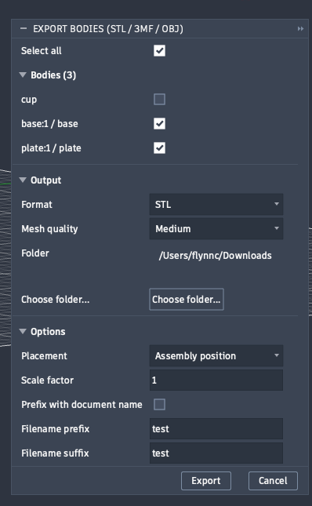
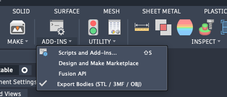

# Export Bodies for Fusion 360

Export every body in your Fusion 360 design as its own STL, 3MF or OBJ file, in one click.

## Features

- Select which bodies to export, or select all
- Export as STL, 3MF or OBJ
- Choose mesh quality
- Keep assembly position or change placement
- Apply a scale factor
- Add a filename prefix and suffix, with an optional document-name prefix
- Choose your output folder
- Remembers your last settings

## Install

1. Go to the [Releases page](../../releases/latest) and download `ExportBodiesSTL.zip`.
2. Unzip it. You will get a folder named `ExportBodiesSTL` and an `INSTALL.txt` file.
3. In Fusion, open **Utilities > Add-Ins > Scripts and Add-Ins**.
4. Click the green **+** and select the `ExportBodiesSTL` folder.
5. Select **Export Bodies** and click **Run**. Tick **Run on Startup** to load it automatically.

> Don't use "Code > Download ZIP". GitHub renames that folder to `...-main`, and Fusion expects the folder name to match the add-in name. Always use the zip from the Releases page.

## Use

1. Open your design in Fusion.
2. Run **Export Bodies** from the add-ins menu.

   

3. Tick the bodies you want, then pick the format, mesh quality and folder.
4. Click **Export**.

## Video walkthrough

[Watch on YouTube](https://www.youtube.com/@CodeandCraft3D)

## Youtube Channel

[YouTube](https://www.youtube.com/@CodeandCraft3D)

## Notes

- Version 1.1.0. Tested on Fusion for Mac. Windows reports are welcome in [Issues](../../issues).
- Free for personal and commercial use under the MIT license.

## License

MIT. See [LICENSE](LICENSE).
